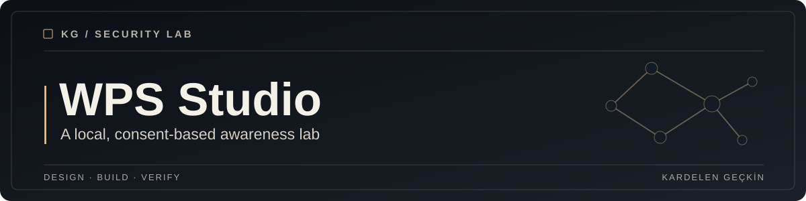

<div align="center">



# WPS Awareness Lab

**One maintained repository for local, consent-based security awareness demonstrations.**

[Quick start](#quick-start) · [Consolidation plan](docs/MIGRATION.md) · [Architecture](docs/ARCHITECTURE.md) · [Security](docs/SECURITY.md)

</div>

## Why this repository exists

This repository is the proposed successor to both [WPS](https://github.com/kgeckin/WPS) and the former WPS2.0 implementation. The two projects independently implemented the same educational campaign management and awareness workflow. This consolidation preserves their useful concepts while establishing a safer local demonstration built around synthetic data.

**WPS Awareness Lab does not impersonate a real login page, ask for credentials, send WhatsApp messages, automate outreach, import customer databases or monitor participants.** It is an explicitly labeled awareness training demonstration. It is not a production security platform.

## Features

* **Dashboard:** responsive browser interface with calm dark/light themes, local campaign status and acknowledgement activity.
* **Desktop:** lightweight read-only Tkinter campaign overview, using the same local data as the browser.
* **CLI:** initialize, status, issue a short-lived synthetic practice link, anonymized CSV report, desktop and local web server.
* **Training:** transparent educational page with three security practices and one explicit consented acknowledgement action.
* **Link integrity:** signed links that expire after 15 minutes, refer only to synthetic identifiers, and work only for consented demo participants in active campaigns.
* **Privacy:** no passwords, email addresses, phone numbers, IP addresses, user-agent collection, real recipient lists or outbound delivery.
* **Security:** locally generated persistent secret, single-use session acknowledgement with CSRF validation, local-only network bind, constrained request sizes, no external JS, and strict response headers.
* **Persistence:** minimal SQLite schema. CSV export is restricted to campaign, synthetic alias, event type and timestamp. Spreadsheet formula injection is escaped.
* **Quality:** pytest checks for input constraints, malicious links, CSRF, replay, export filtering, local network access and expected API behavior.

## Quick start

Python 3.11 or newer is recommended. No ChromeDriver, MySQL, Selenium, actual messaging account or external service is required.

```bash
git clone https://github.com/kgeckin/WPS2.0.git
cd WPS2.0
python -m venv .venv
```

Activate the virtual environment, then:

```bash
python -m pip install -r requirements.txt
python main.py init
python main.py status
python main.py serve
```

Open **http://127.0.0.1:5000**. The service binds only to loopback. Stop it with Ctrl+C.

On Windows PowerShell, virtual environment activation is `.venv\Scripts\Activate.ps1`. On Linux, it is `source .venv/bin/activate`. The optional desktop window requires Tkinter installed on your local machine and a desktop session.

**For testing the consolidation before the Pull Request is merged**, check out the feature branch instead of main:

```bash
git switch refactor/unified-awareness-lab
```

### Test one simulated acknowledgement

In a second local terminal:

```bash
python main.py link --campaign 1 --participant 1
```

Open the printed local practice URL in the same computer's browser. It has a signed fifteen-minute lifetime. Review the educational guidance and click the acknowledgement button. Return to the dashboard and inspect the local event count.

The demo has nine completely fictional participant codes. It does not accept bulk phone or email imports.

### CLI

```bash
python main.py --help
python main.py init
python main.py status
python main.py link --campaign 1 --participant 1
python main.py report > local-report.csv
python main.py desktop
python main.py serve
```

CSV reports should remain local. The ignored `var/` directory contains a confidential `secret.key` and a SQLite database. **Never commit the contents of `var/`**.

## Repository structure

```text
WPS2.0/
├── wps_lab/
│   ├── app.py                # Flask dashboard, local APIs and consented practice
│   ├── cli.py                # Local command-line workflows
│   ├── desktop.py            # Read-only Tkinter view
│   ├── settings.py           # Private random signing key
│   ├── storage.py            # SQLite event and campaign model
│   ├── tokens.py             # Short-lived signed demo links
│   ├── static/               # Local CSS and JavaScript only
│   └── templates/            # Transparent learning and dashboard pages
├── tests/                    # Local, isolated security and workflow tests
├── docs/
│   ├── ARCHITECTURE.md
│   ├── SECURITY.md
│   └── MIGRATION.md
├── var/                      # Ignored, generated locally
├── main.py
├── requirements.txt
└── README.md
```

## Tests

```bash
python -m pip install -r requirements-dev.txt
python -m pytest -q tests
```

The source code and tests require verification in an environment with Flask installed. Browser and cross-platform integration should be reviewed before the consolidated branch is merged.

## Legacy and project history

The earlier WPS and WPS2.0 prototypes used MySQL, Selenium and browser messaging automation. Those code paths and the tracked ChromeDriver binary are being **removed from the new maintained working tree**. Their original repository/commit history remains available separately for authorized archival review.

There is **no automatic migration of real users, historical events, passwords, phone numbers or organizational data** into the consolidated SQLite database. See the [migration plan](docs/MIGRATION.md) before deciding whether to archive the old WPS repository. This preserves the existing source lineage without pretending that legacy deployments have been tested with the new schema.

## Security and scope

This is a local educational demonstration, not an online phishing simulator or service intended for customer networks. Do not expose the local API to the internet or copy old real recipient data into the new project. Read [Security](docs/SECURITY.md).

## License

No new license has been selected for this consolidation. Original ownership and redistribution rights, including any earlier third-party assets, must be reviewed separately.
